# Catlytics

[](LICENSE)


[English](README.md) · **Español**

Catlytics es un reproductor de música para Android que funciona sin conexión: reproduce las canciones que ya tienes guardadas en el dispositivo y lleva un registro privado de lo que escuchas. No necesita cuenta, no tiene anuncios y no usa la red; la app ni siquiera pide el permiso `INTERNET`.

<p>
  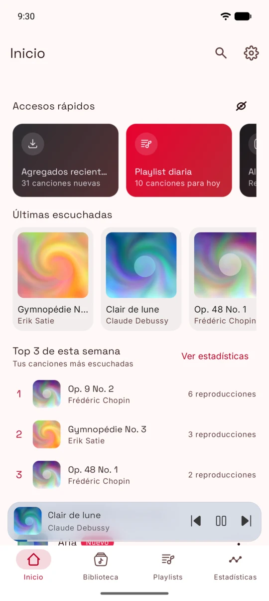
  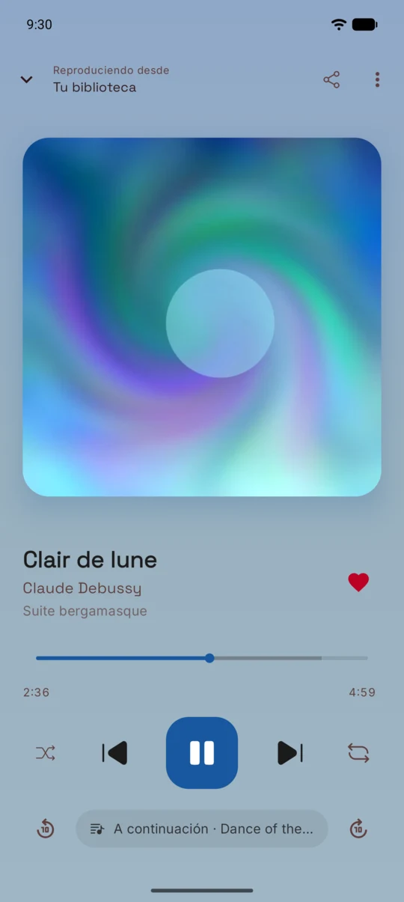
  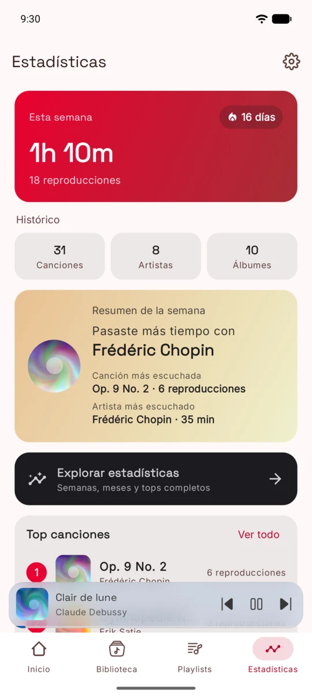
  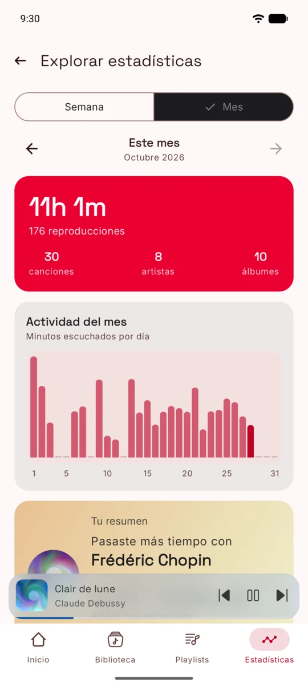
</p>

## Funcionalidades

| Funcionalidad | Detalle |
|---|---|
| 🎵 **Biblioteca local** | Escanea MediaStore y permite ver canciones, álbumes, artistas y carpetas, con búsqueda, índice alfabético, carpetas ocultas y filtros de escaneo por duración y tamaño. |
| ▶️ **Reproducción** | Media3 con servicio en primer plano y notificación multimedia, aleatorio y repetición, cola reordenable, reproducción sin pausas o crossfade, presets del ecualizador del dispositivo y temporizador de sueño. |
| 📊 **Estadísticas de escucha** | Cada reproducción se guarda en el dispositivo. Panel semanal con racha y resumen, y exploración por semana o mes con gráficas de actividad diaria y tops de canciones, artistas y álbumes. |
| 📝 **Playlists** | Me gusta, playlists propias con portada y descripción, reordenar arrastrando, deshacer al quitar canciones y exportar a M3U8. Inicio sugiere una playlist diaria, lo agregado recientemente y aleatorio de toda la biblioteca. |
| ✏️ **Edición de la biblioteca** | Cambia título, artista, álbum y portada de una canción, de un álbum completo o de varias canciones a la vez; renombra o une artistas y ponles imagen. Las ediciones nunca reescriben los datos escaneados y se pueden revertir; si quieres, también se guardan en las etiquetas del archivo con TagLib. |
| 💾 **Respaldos** | Un solo archivo JSON con playlists, historial de escucha, artistas unidos, ediciones e imágenes, que al restaurar se puede combinar o reemplazar. |
| 📻 **Widget** | Widget de pantalla de inicio con estilo de casete que refleja la reproducción. |
| 📱 **Interfaz adaptable** | Barra inferior en teléfonos, riel de navegación y paneles de lista y detalle en tablets y plegables. |
| 🌗 **Temas e idiomas** | Tema del sistema, claro u oscuro; español e inglés, con cambio de idioma dentro de la app. |

## Capturas

| | | | |
|:-:|:-:|:-:|:-:|
|  | 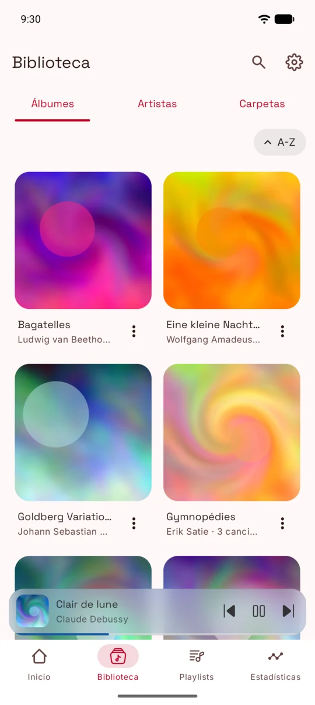 | 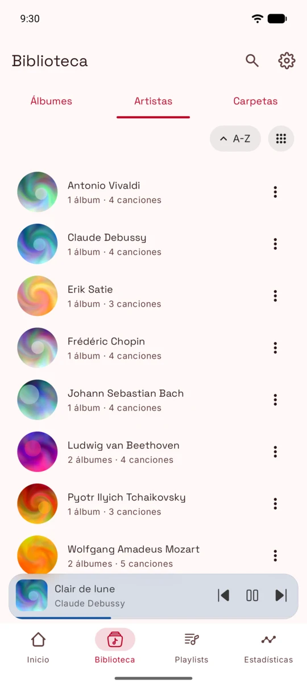 | 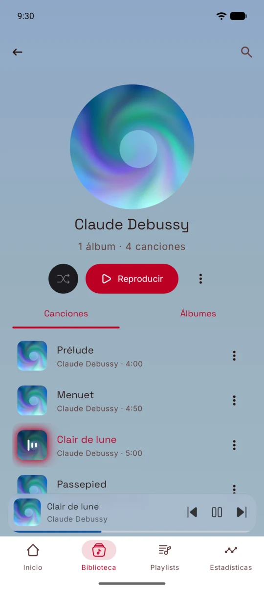 |
| Inicio | Álbumes | Artistas | Artista |
| 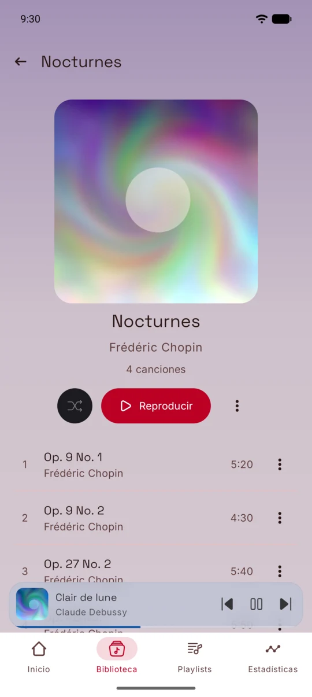 | 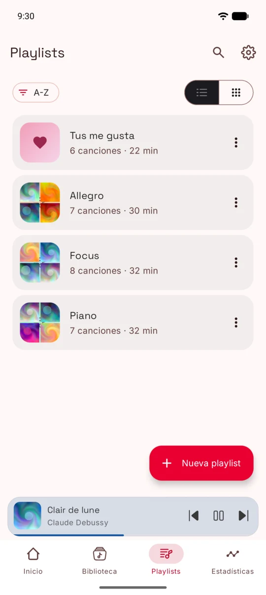 | 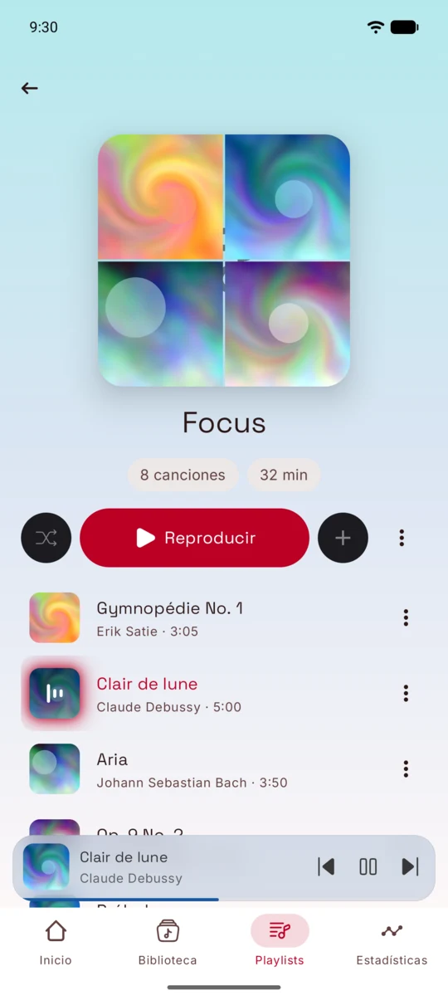 |  |
| Álbum | Playlists | Playlist | Reproduciendo |
| 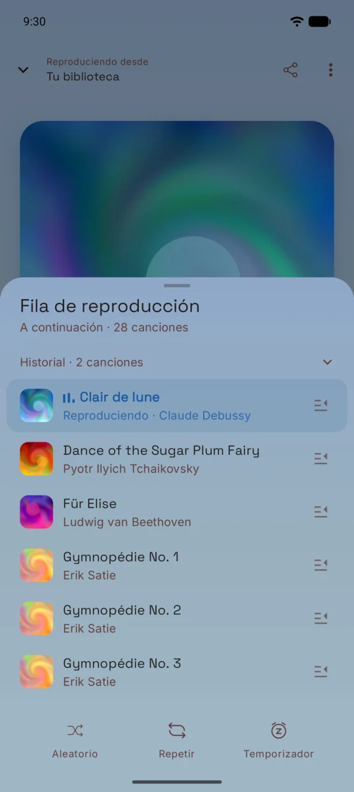 |  |  | 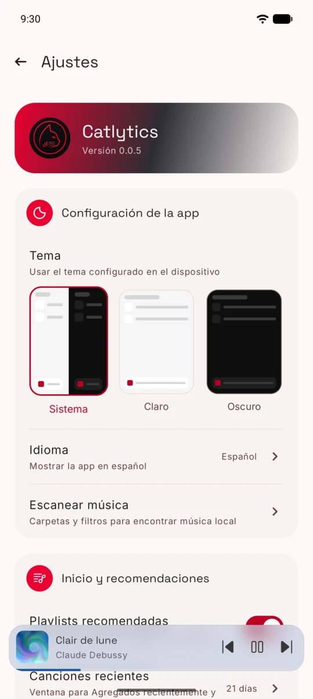 |
| Cola | Estadísticas | Explorar | Ajustes |

La biblioteca de demostración usa obras de dominio público con audio generado y portadas abstractas.

## Arquitectura

Catlytics sigue **Clean Architecture** con un build modular de Gradle: presentación, dominio y datos viven en módulos separados, y las dependencias apuntan hacia el dominio.

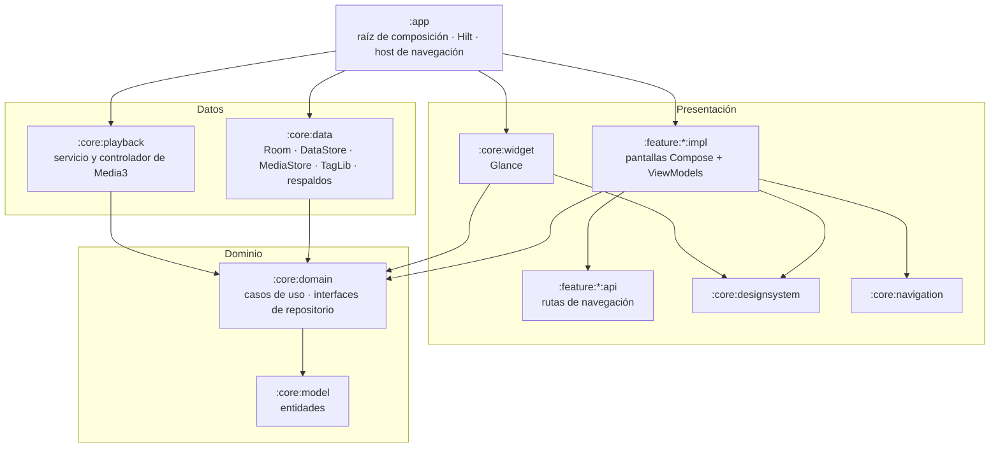

### Capas

- **Dominio** (`:core:model`, `:core:domain`). Entidades, casos de uso y las interfaces de repositorio que necesitan (`LibraryRepository`, `PlaybackController`, `PlaybackEventRepository`…). Este código no importa nada de Android: es Kotlin puro que se prueba sin dispositivo.
- **Datos** (`:core:data`, `:core:playback`). Implementan las interfaces del dominio: escaneo de MediaStore, Room para reproducciones y ediciones, DataStore para preferencias y playlists, TagLib para escribir etiquetas, respaldos JSON y el servicio de reproducción de Media3.
- **Presentación** (`:feature:*`, `:core:designsystem`, `:core:navigation`, `:core:widget`). Pantallas en Jetpack Compose con MVVM: cada ViewModel llama a casos de uso y expone el estado de la UI como un `StateFlow` inmutable, los efectos de una sola vez con un `SharedFlow` y los mensajes como `UiText`, que se resuelve en la UI.

### Regla de dependencias

- Los módulos de feature dependen solo del dominio y de los módulos de UI compartidos, **nunca de `:core:data`**: hablan con los datos a través de casos de uso e interfaces de repositorio.
- `:core:data` y `:core:playback` dependen del dominio, no al revés.
- `:app` es la raíz de composición: Hilt une cada interfaz de repositorio con su implementación y `appEntries()` registra todas las pantallas en el grafo de navegación.
- Cada feature se divide en `api` (rutas serializables de Navigation 3) e `impl` (pantallas y ViewModels), así ninguna feature depende de la implementación de otra.
- `:core:playback` usa además `:core:designsystem` para los textos localizados de la notificación multimedia.

### Decisiones de diseño

- **Biblioteca offline-first.** El escaneo de MediaStore se mantiene en memoria y se reconstruye al actualizar; Room y DataStore solo guardan lo que crea el usuario.
- **Ediciones aplicadas al leer.** Las ediciones de metadatos, los artistas unidos y las imágenes de artista se aplican sobre los datos escaneados al leerlos, y las estadísticas consultan una vista de Room que los aplica. El historial se reagrupa tras una edición sin reescribir los eventos guardados.
- **Modelo de cola puro.** El orden de la cola, el aleatorio y las canciones agregadas a mano viven en `PlaybackQueueModel`, puro y con tests unitarios; el controlador de Media3 solo aplica sus resultados.
- **Navigation 3** con una pila por pestaña de la barra inferior y escenas de lista y detalle adaptables de Material 3.

### Tecnologías

Kotlin 2.4 · Jetpack Compose con Material 3 y layouts adaptables · Navigation 3 · Hilt · Room · DataStore · Media3 · Glance · Coil 3 · kotlinx.serialization · TagLib (`io.github.kyant0:taglib`) · plugins de convención de Gradle con catálogo de versiones.

## Compilar

Requisitos:

- JDK 21
- Android SDK con API 37 (compileSdk/targetSdk 37; la app funciona desde Android 9, API 28)
- Una versión de Android Studio compatible con Android Gradle Plugin 9.4

```bash
./gradlew :app:assembleDebug    # APK debug
./gradlew :app:installDebug     # instala en un dispositivo o emulador conectado
```

Todavía no hay versiones release publicadas.

## Tests y calidad de código

```bash
./gradlew test                          # tests unitarios (JUnit 4, coroutines-test, Robolectric)
./gradlew connectedDebugAndroidTest     # tests instrumentados de Compose, necesita dispositivo o emulador
./gradlew detekt lintDebug              # análisis estático
./gradlew detekt --auto-correct         # aplica el formato de ktlint
```

- Más de 500 tests unitarios cubren casos de uso, ViewModels, repositorios, migraciones de Room, respaldos y la cola de reproducción; 54 tests instrumentados cubren la UI de Compose.
- detekt (con ktlint y las reglas de Compose) y Android Lint corren en todos los módulos mediante un plugin de convención, con baselines por módulo para los hallazgos que ya existían.
- `connectedDebugAndroidTest` instala en todos los dispositivos conectados; si hay más de uno, usa `ANDROID_SERIAL` para elegir.

## Contribuir

Los commits siguen [Conventional Commits](https://www.conventionalcommits.org/es/) y `CHANGELOG.md` lo genera Release Please. Antes de abrir un pull request, corre `./gradlew test detekt lintDebug`.

## Licencia

Catlytics se publica bajo la [licencia MIT](LICENSE).

Los avisos de terceros se generan al compilar y se muestran en la app en Ajustes → Acerca de Catlytics → Licencias de código abierto. Catlytics incluye [TagLib](https://github.com/taglib/taglib) como biblioteca nativa sin modificar a través de `io.github.kyant0:taglib` (Apache-2.0); TagLib tiene doble licencia LGPL-2.1 y MPL-1.1, y su código fuente está en https://github.com/taglib/taglib.
