# Catlytics

[](LICENSE)


**English** · [Español](README.es.md)

Catlytics is an offline-first music player for Android that plays the songs already stored on your device and keeps a private record of what you listen to. No account, no ads, and no network access: the app does not even request the `INTERNET` permission.

<p>
  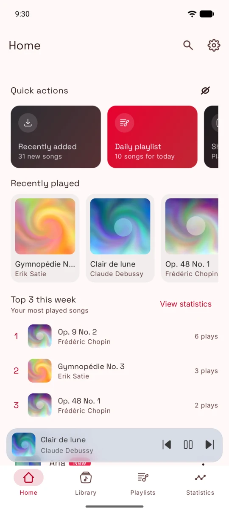
  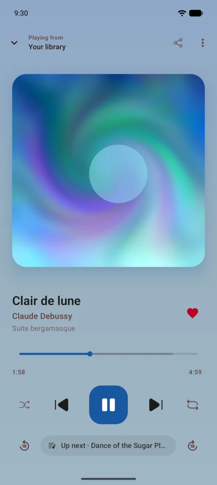
  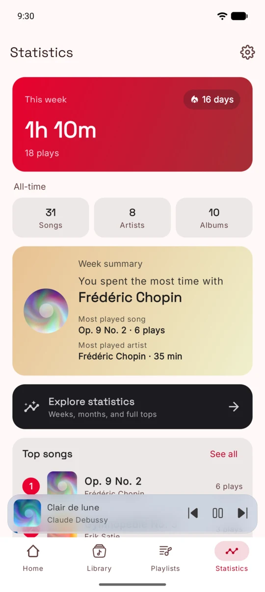
  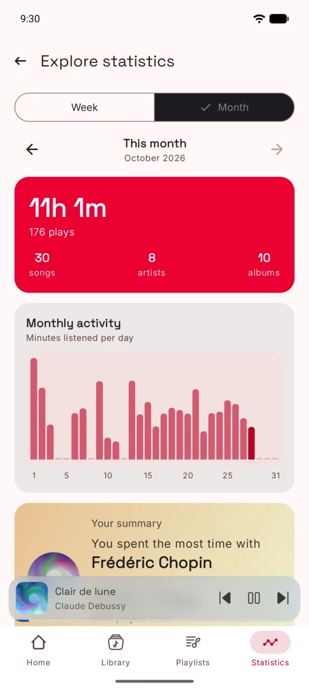
</p>

## Features

| Feature | Details |
|---|---|
| 🎵 **Local library** | Scans MediaStore and browses songs, albums, artists and folders, with search, A–Z fast scroll, hidden folders and duration/size scan filters. |
| ▶️ **Playback** | Media3 with a foreground service and media notification, shuffle and repeat, a reorderable queue, gapless playback or crossfade, device equalizer presets and a sleep timer. |
| 📊 **Listening statistics** | Every play is recorded locally. Weekly dashboard with streak and summary, plus week/month exploration with daily activity charts and top songs, artists and albums. |
| 📝 **Playlists** | Liked songs, custom playlists with covers and descriptions, drag to reorder, undo on removal and M3U8 export. Home suggests a daily playlist, recently added songs and shuffle-all. |
| ✏️ **Library editing** | Edit title, artist, album and artwork for one song, a whole album or many songs at once; rename or merge artists and set artist images. Edits never rewrite scanned data and can be reverted; optionally they are also written to the file tags with TagLib. |
| 💾 **Backups** | A single JSON file with playlists, listening history, artist merges, metadata edits and images, with merge or replace on restore. |
| 📻 **Widget** | Cassette-style home screen widget that mirrors playback. |
| 📱 **Adaptive UI** | Bottom bar on phones, navigation rail and list-detail panes on tablets and foldables. |
| 🌗 **Themes and languages** | System, light and dark themes; Spanish and English, switchable inside the app. |

## Screenshots

| | | | |
|:-:|:-:|:-:|:-:|
|  | 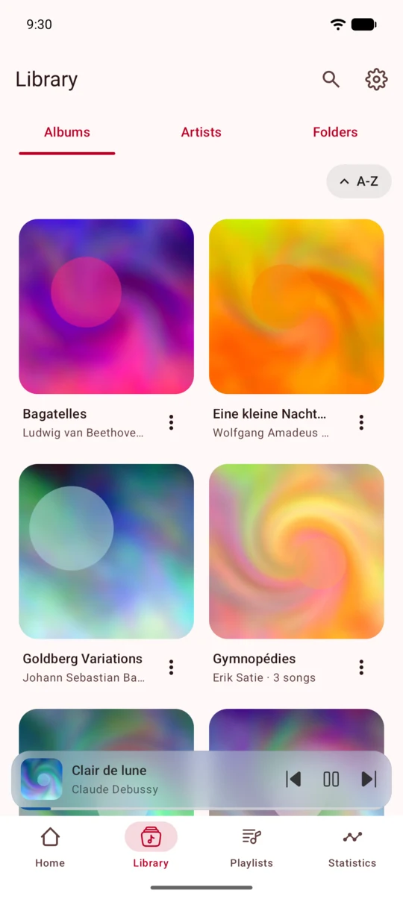 | 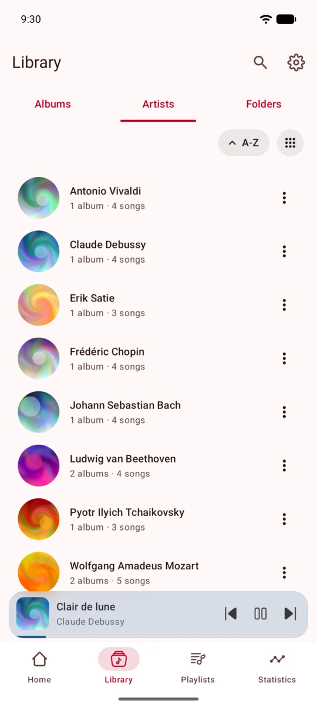 | 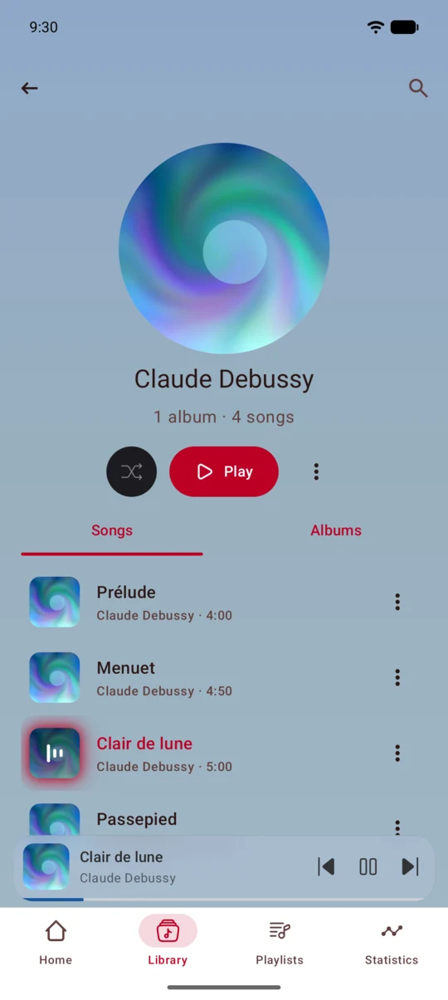 |
| Home | Albums | Artists | Artist |
| 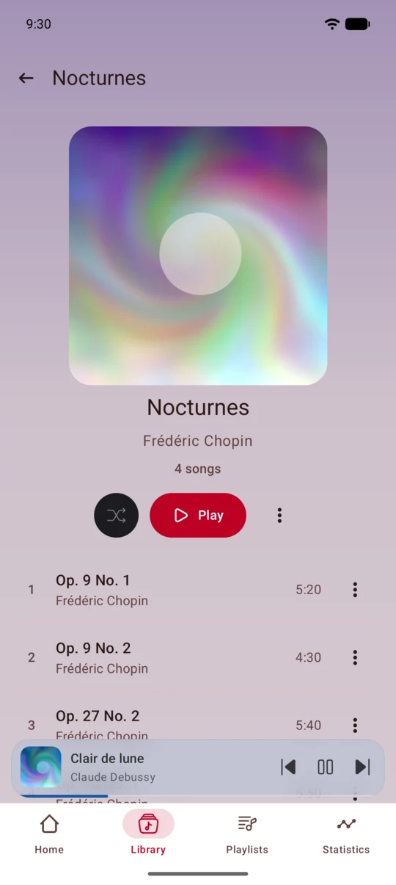 | 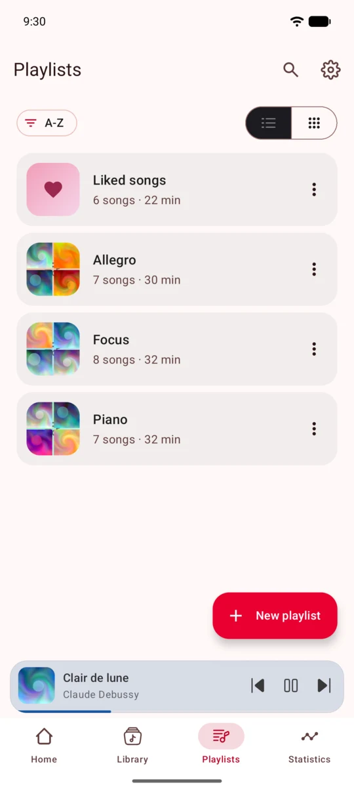 | 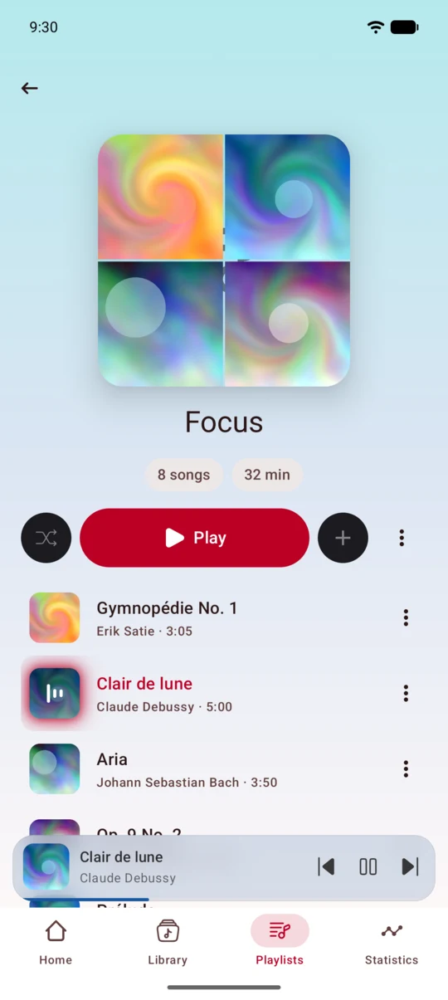 |  |
| Album | Playlists | Playlist | Now playing |
| 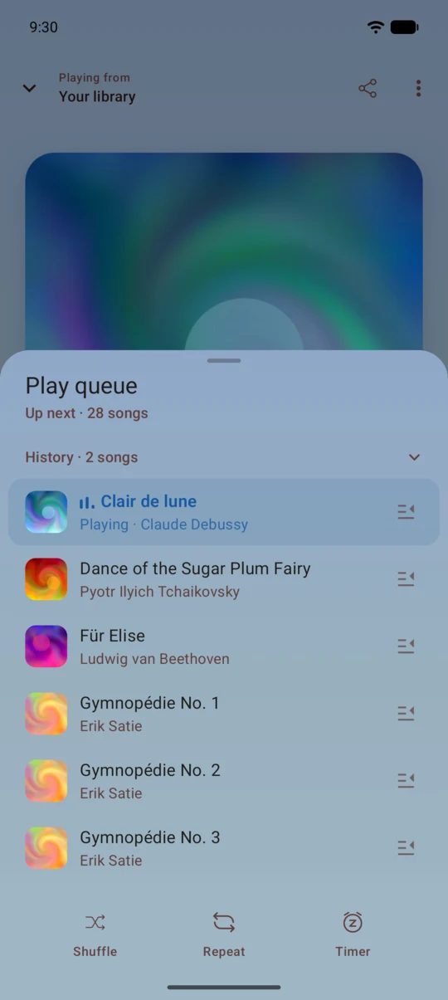 |  |  | 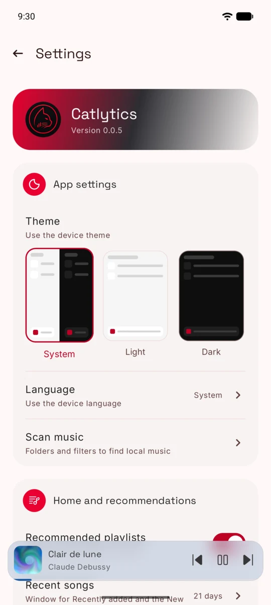 |
| Queue | Statistics | Explore | Settings |

The demo library uses public-domain works with generated audio and abstract covers.

## Architecture

Catlytics follows **Clean Architecture** with a modular Gradle build: presentation, domain and data live in separate modules, and dependencies point inwards towards the domain.

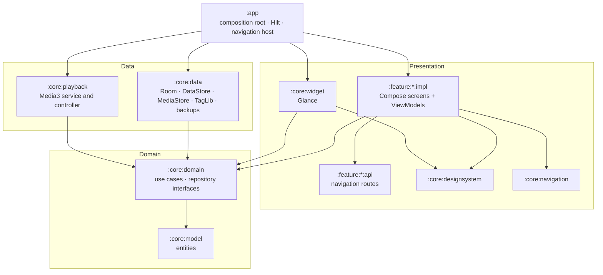

### Layers

- **Domain** (`:core:model`, `:core:domain`). Entities, use cases and the repository interfaces they need (`LibraryRepository`, `PlaybackController`, `PlaybackEventRepository`…). This code has no Android imports, so it is plain Kotlin that can be tested without a device.
- **Data** (`:core:data`, `:core:playback`). Implements the domain interfaces: MediaStore scanning, Room for playback events and edits, DataStore for preferences and playlists, TagLib for tag writing, JSON backups, and the Media3 playback service.
- **Presentation** (`:feature:*`, `:core:designsystem`, `:core:navigation`, `:core:widget`). Jetpack Compose screens with MVVM: each ViewModel calls use cases and exposes an immutable `StateFlow` of UI state, one-shot effects through a `SharedFlow`, and messages as `UiText` resolved in the UI.

### Dependency rule

- Feature modules depend only on the domain and on shared UI modules, **never on `:core:data`**; they talk to data through use cases and repository interfaces.
- `:core:data` and `:core:playback` depend on the domain, not the other way around.
- `:app` is the composition root: Hilt binds each repository interface to its implementation, and `appEntries()` registers every feature screen in the navigation graph.
- Each feature is split into `api` (serializable Navigation 3 routes) and `impl` (screens and ViewModels), so features don't depend on each other's implementations.
- `:core:playback` also uses `:core:designsystem` for localized strings in the media notification.

### Notable design decisions

- **Offline-first library.** The MediaStore scan is held in memory and rebuilt on refresh; Room and DataStore only store what the user creates.
- **Edits applied at read time.** Metadata overrides, artist merges and artist images are layered over the scanned data when it is read, and statistics query a Room view that applies them. Past history regroups after an edit without rewriting stored events.
- **Pure playback queue model.** Queue order, shuffle and manually added tracks live in a pure, unit-tested `PlaybackQueueModel`; the Media3 controller only applies its results.
- **Navigation 3** with one back stack per bottom-bar tab and Material 3 adaptive list-detail scenes.

### Tech stack

Kotlin 2.4 · Jetpack Compose with Material 3 and adaptive layouts · Navigation 3 · Hilt · Room · DataStore · Media3 · Glance · Coil 3 · kotlinx.serialization · TagLib (`io.github.kyant0:taglib`) · Gradle convention plugins with a version catalog.

## Building

Requirements:

- JDK 21
- Android SDK with API 37 (compileSdk/targetSdk 37; the app runs on Android 9, API 28, and newer)
- An Android Studio version that supports Android Gradle Plugin 9.4

```bash
./gradlew :app:assembleDebug    # debug APK
./gradlew :app:installDebug     # install on a connected device or emulator
```

There are no published release builds yet.

## Testing and code quality

```bash
./gradlew test                          # unit tests (JUnit 4, coroutines-test, Robolectric)
./gradlew connectedDebugAndroidTest     # Compose instrumented tests, needs a device or emulator
./gradlew detekt lintDebug              # static analysis
./gradlew detekt --auto-correct         # apply ktlint formatting
```

- More than 500 unit tests cover use cases, ViewModels, repositories, Room migrations, backups and the playback queue; 54 instrumented tests cover Compose UI.
- detekt (with the ktlint wrapper and Compose rules) and Android Lint run on every module through a convention plugin, with per-module baselines for pre-existing findings.
- `connectedDebugAndroidTest` installs on every attached device; with more than one connected, set `ANDROID_SERIAL` to choose one.

## Contributing

Commits follow [Conventional Commits](https://www.conventionalcommits.org/), and `CHANGELOG.md` is generated by Release Please. Run `./gradlew test detekt lintDebug` before opening a pull request.

## License

Catlytics is released under the [MIT License](LICENSE).

Third-party notices are generated at build time and shown in the app under Settings → About Catlytics → Open source licenses. Catlytics bundles [TagLib](https://github.com/taglib/taglib) as an unmodified native library through `io.github.kyant0:taglib` (Apache-2.0); TagLib itself is dual-licensed under LGPL-2.1 and MPL-1.1, and its source code is available at https://github.com/taglib/taglib.
